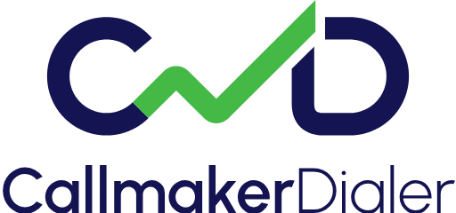

# CallmakerDialer logo

The CallmakerDialer logo in every layout and color version needed for screen, print, app icons and
social media. Use these files as they are: don't redraw, re-color or retype the logo.


## Which file to use

| Need | File |
|---|---|
| Website header, documents, presentations on white | `svg/callmaker-dialer-horizontal-color.svg` |
| Same, on a dark or navy background | `svg/callmaker-dialer-horizontal-inverted.svg` |
| Square-ish space: cover pages, signage, merchandise | `svg/callmaker-dialer-stacked-*.svg` |
| Small spaces where the name is already shown | `svg/callmaker-dialer-symbol-*.svg` |
| Print | `pdf/*.pdf` (vector, text outlined) |
| Word, PowerPoint, email signatures, anywhere SVG won't load | `png/*-1024.png` or `png/*-2048.png` (transparent) |
| Browser tab | `icons/favicon.svg`, with `icons/favicon.ico` as fallback |
| iOS home screen | `icons/apple-touch-icon.png` (180 px) |
| Android / web app manifest | `icons/icon-192.png`, `icons/icon-512.png`, `icons/icon-maskable-512.png` |
| App stores, large tiles | `icons/icon-1024.png` |
| Link previews (Open Graph, LinkedIn, Slack) | `social/share-1200x630-navy.png` or `social/share-1200x630-white.png` |
| Profile pictures | `social/avatar-400-navy.png` or `social/avatar-400-white.png` |

## Layouts

| Horizontal | Stacked | Symbol |
|---|---|---|
|  |  |  |
| The default: symbol left, wordmark right. | Symbol above the wordmark. | The mark on its own. |

## Color versions

| Version | Symbol | Rising line | Wordmark | Use on |
|---|---|---|---|---|
| `color` | Navy | Green | Navy | White and light backgrounds. The primary version. |
| `inverted` | White | Green | White | Navy and dark backgrounds. |
| `mono-navy` | Navy | Navy | Navy | One-color print on light backgrounds. |
| `mono-white` | White | White | White | One color on dark backgrounds or photos. |
| `mono-black` | Black | Black | Black | Black-only print. |

The space around the rising green line is part of the logo and is transparent in every file, so
each version works on any background color.

## Colors

| | HEX | RGB | CMYK (approx.) |
|---|---|---|---|
| Navy | `#141452` | 20, 20, 82 | 76, 76, 0, 68 |
| Green | `#45B945` | 69, 185, 69 | 63, 0, 63, 27 |
| White | `#FFFFFF` | 255, 255, 255 | 0, 0, 0, 0 |

The CMYK values are converted from RGB. Ask your printer for a proof before a large print run.

## Typography

The wordmark reads **CallmakerDialer**: one word, small m, no space. "Callmaker" is set in
**Urbanist SemiBold** and "Dialer" in **Urbanist Light**.

The logo files have the text converted to outlines, so no font needs to be installed to use them.
Urbanist is a free font under the SIL Open Font License: https://fonts.google.com/specimen/Urbanist

## Clear space and minimum size

- **Clear space:** keep space around the logo at least the height of the "C" in the wordmark, on
  every side. For the symbol on its own, use the thickness of its line.
- **Horizontal:** at least 120 px wide on screen, 30 mm in print.
- **Stacked:** at least 80 px wide on screen, 20 mm in print.
- **Symbol:** at least 24 px wide on screen, 8 mm in print.

## Please don't

- Change the colors or swap them between parts of the logo.
- Retype the wordmark, add a space, use a capital M, or set it in another font.
- Stretch, rotate or outline the logo, or add shadows or other effects.
- Put the `color` version on a dark background or the `inverted` version on a light one.
- Fill the space around the rising line with a color.

## Files

```
svg/     15 files: 3 layouts x 5 color versions, vector
pdf/     15 files: the same as vector PDF, for print
png/     45 files: the same at 512, 1024 and 2048 px wide, transparent
icons/   favicon (svg, ico, 16/32/48 px), apple-touch-icon, 192/512/1024 px app icons,
         maskable and white versions, plus the square SVG artwork they come from
social/  link-preview images (1200 x 630) and 400 px avatars, navy and white
```
